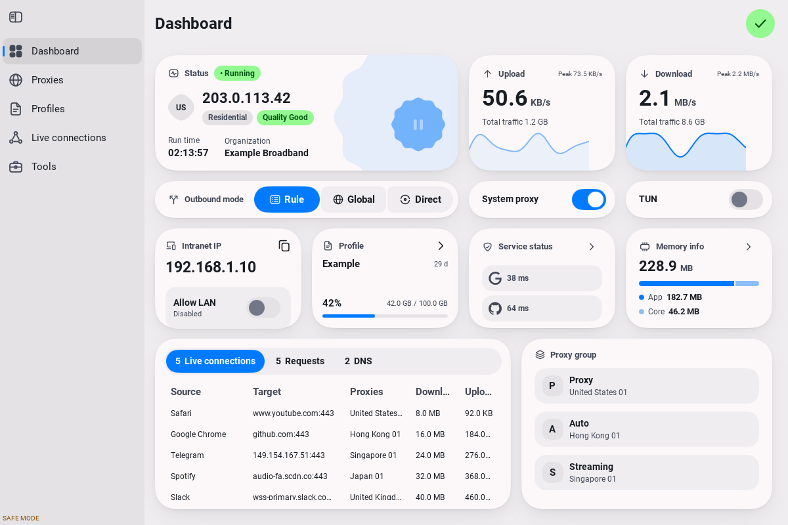

# FlClash MyGo

A desktop port of [FlClash](https://github.com/chen08209/FlClash), written in Go with [MyGo's native UI](https://github.com/egoist/mygo). The app draws its interface directly; it does not embed Flutter, HTML, JavaScript UI, or a webview. Windows, macOS, and Linux are the only build targets.

**The desktop implementation runs, but exact UI/UX parity is not complete.** See [the parity checklist](docs/PARITY.md) for the remaining differences and platform validation requirements. The [agent handoff](docs/AGENT_HANDOFF.md) contains the current checkpoint and concrete resume steps.



The screenshot uses deterministic test fixtures. The running app reads live values from its core. Original Flutter widget reference renders are under [docs/reference](docs/reference), with their harness and limits documented in [tool/reference](tool/reference/README.md).

## Build and run

Install **Go 1.27.3** or later, then:

```sh
git clone --recurse-submodules https://github.com/BIGGASSS/FlClash-MyGo.git
cd FlClash-MyGo
make build
make run
```

On Windows, use `powershell -File scripts/build.ps1`, then run `build/windows-amd64/flclash.exe` (or `windows-arm64` on ARM Windows). Keep `flclash-core` beside the UI executable. Flutter, Node, Bun, Rust, and a C compiler are not needed to build either executable.

On Linux, install GTK 3, Pango, Fontconfig, and OpenGL libraries. A working desktop session is needed to open the window. Tray support depends on the desktop's StatusNotifier/AppIndicator support; system proxy settings currently use GNOME's GSettings. `pkexec` and a desktop authentication agent are needed for TUN elevation.

```sh
make safe       # UI without starting the core or changing host networking
make package    # portable archive; macOS archive contains an .app bundle
```

TUN requests administrator authorization for the core through UAC, macOS's authorization dialog, or Linux PolicyKit. The UI continues to run as the desktop user. Ordinary proxy mode does not require elevation. macOS and Windows elevation paths still need real desktop smoke testing.

Cross-compile either supported architecture:

```sh
GOOS=windows GOARCH=arm64 bash scripts/build.sh
GOOS=darwin GOARCH=arm64 bash scripts/build.sh
GOOS=linux GOARCH=amd64 bash scripts/build.sh
```

The desktop workflow tests the code and produces archives for all six OS/architecture combinations. There are no mobile build jobs. Archives are unsigned development builds, not signed installers.

## Using the app

Import a Clash/mihomo YAML file, a subscription URL, or share links from the clipboard. Profiles can be selected, updated, exported, and edited with the native code editor or native nested forms. Rules, proxy definitions, groups, providers, DNS, sniffer, NTP, TUN, and overrides retain fields the UI does not recognize.

The dashboard and record views use the retained FlClash core's real traffic, connection, request, DNS, provider, probe, and log APIs. Proxy latency tests and group selection use the same core. Each profile keeps its own selected nodes and group expansion. The proxy view supports both the original group list and tabs, density/card/icon modes, timeout filtering, and provider import/edit/export. Script transforms use FlClash's pinned QuickJS-NG engine, with `main(config)`, console methods, promises, a ten-second timeout, and the original 256 MiB heap ceiling.

Preferences and profiles live in a separate `FlClash-MyGo` configuration directory. This app does not reuse the installed Flutter client's preferences or its privileged helper service. Local and WebDAV backups round-trip this app's data. Restore also imports FlClash's current SQLite and legacy JSON archives, including scripts, custom groups/proxies/dialers, rules, subscription metadata, and local rule sets. Unknown source fields remain in a private import snapshot for later migrations. Native backup export is not yet a Flutter-compatible archive. System proxy changes keep a recovery snapshot and restore previous values when disabled or the app exits.

Useful options:

```sh
flclash --safe-mode --data-dir /tmp/flclash-preview
flclash --core /absolute/path/to/flclash-core
flclash --render dashboard.png --page dashboard --dark
flclash --version
```

## Verify

```sh
CGO_ENABLED=0 go test ./...
CGO_ENABLED=0 go vet ./...
cd core
CGO_ENABLED=0 go test ./...
CGO_ENABLED=0 go vet . ./cmd/...
```

After building the core, run the actual process/protocol integration test from the repository root:

```sh
FLCLASH_TEST_CORE="$PWD/build/linux-amd64/flclash-core" CGO_ENABLED=0 go test ./internal/coreclient -run TestRealCore -v
```

Tests use private temporary data and loopback endpoints. UI tests run headlessly at several desktop widths in light and dark. [Architecture and provenance](docs/ARCHITECTURE.md) describe the core boundary and the small local MyGo changes.

## License

GPL-3.0, inherited from FlClash. FlClash's core, data, localization catalogs, service artwork, and branding retain their upstream attribution. The pinned MyGo and QuickJS-NG sources are MIT licensed; their licenses are preserved under `third_party`. Bundled desktop archives include third-party notices.
